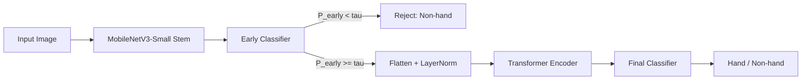

# HNH40K Architecture

## Overview
The HNH40K model implements a Cascaded Risk-Aware Filter for hand vs. non-hand discrimination. The design uses computational asymmetry: a lightweight stem quickly rejects low-risk negatives, while a compact attention layer performs deeper scrutiny only when needed.

## Proposed Method (Section 4)
We propose a Cascaded Risk-Aware Filter designed for robust hand vs. non-hand discrimination. To address the conflict between edge-efficiency and high-risk distractor rejection, the architecture applies computational asymmetry.

### 4.1 Dual-Stage Cascaded Inference
Stage 1 is a truncated MobileNetV3-Small stem that extracts local morphological features. An auxiliary classifier provides an early-exit probability $P_{early}$. If $P_{early} < \tau$ (where $\tau = 0.1$), the input is rejected as a low-risk negative, bypassing Stage 2. For ambiguous or high-risk samples, the feature map is passed to Stage 2: a single-layer Transformer Encoder that captures global structural dependencies (for example, finger-to-palm ratios) to ensure structural robustness.

### 4.2 Risk-Weighted Focal Loss (RWFL)
To optimize for the HNH40K risk-aware taxonomy, we use RWFL, which applies a penalty scalar $\lambda_{risk}$ to the binary focal loss. Based on the taxonomy defined in Table 3, $\lambda_{risk} = 2.0$ for high-risk negatives (faces, electronics) and $\lambda_{risk} = 0.5$ for low-risk backgrounds, forcing the model to prioritize calibration on visually similar distractors.

Note: The current code wires RWFL through per-sample `risk_weights` from the dataset loader; the default loader sets all weights to 1.0. Integrate taxonomy-specific weights in `dataset.py` to fully realize the risk-aware training regime.

## Architecture Details (Code-Accurate)

### Stage 1: Fast Rejector (Stem)
- Backbone: `mobilenet_v3_small` (ImageNet weights).
- Truncation: first 7 `features` blocks.
- Output: 40-channel feature map.
- Early classifier: global average pool + linear layer to 1 logit.

### Stage 2: Structural Scrutinizer (Attention)
- Tokenization: flatten spatial feature map to sequence length $H \times W$.
- Normalization: `LayerNorm` on channel dimension.
- Self-attention: single `TransformerEncoderLayer` (4 heads, FFN dim 128).
- Aggregation: mean pool over sequence.
- Final classifier: MLP (40 -> 64 -> 1) with SiLU and dropout.

### Early-Exit Policy
- During inference, the model returns the early logit if batch size is 1 and $\sigma(\text{early}) < \tau$.
- If batch size > 1, Stage 2 always runs for vectorized evaluation.

## Training Objective
The training loop optimizes a dual objective:
- Final loss: RWFL on Stage 2 logit.
- Early loss: RWFL on Stage 1 logit.
- Total loss: `loss_final + 0.4 * loss_early`.

Optimization:
- Optimizer: AdamW (lr 1e-4, weight decay 1e-4).
- Scheduler: cosine annealing over epochs.
- Gradient clipping: max norm 1.0.

## Data Pipeline
- Input resolution: 192 x 160.
- Normalization: ImageNet mean/std.
- Dataset: folder-based binary split (`hand/`, `non-hand/`).

## Inference Flow (Mermaid)

## Key Files
- `model.py`: cascaded model definition and early-exit logic.
- `losses.py`: Risk-Weighted Focal Loss.
- `train.py`: dual-objective training and evaluation.
- `dataset.py`: dataset loader and risk weights.
- `main.py`: entry point for train/evaluate workflows.
